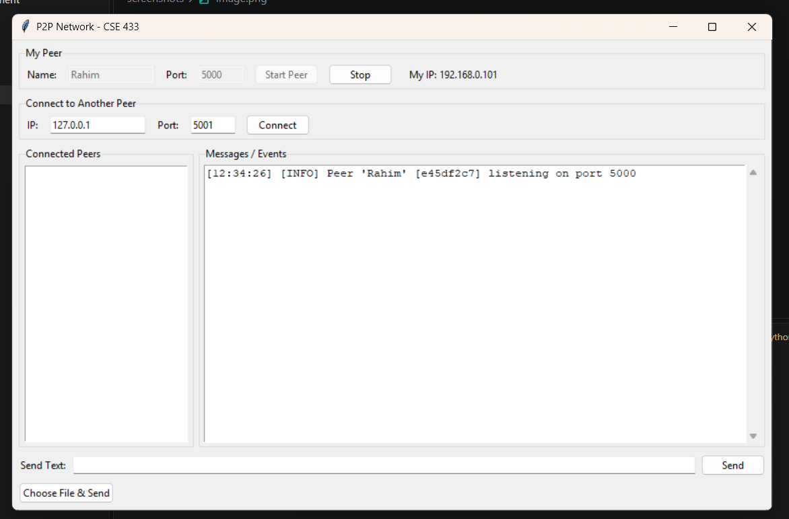
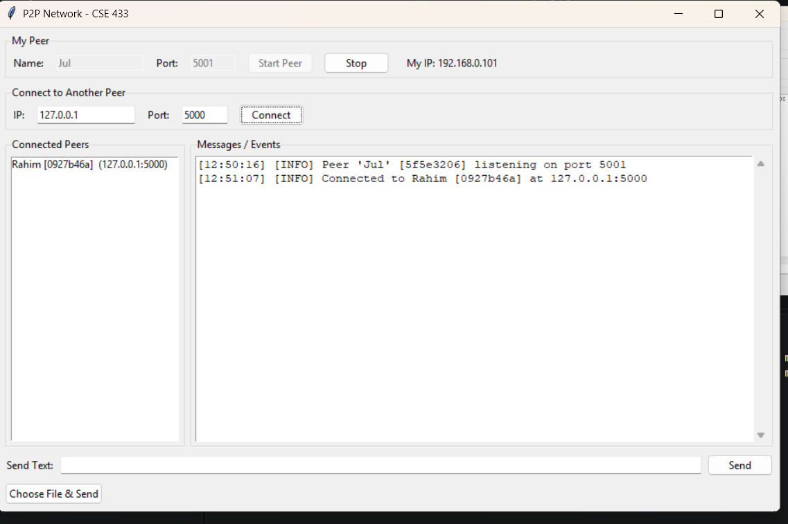
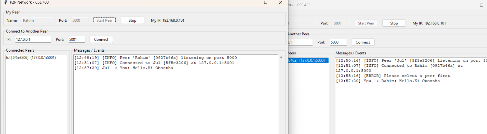
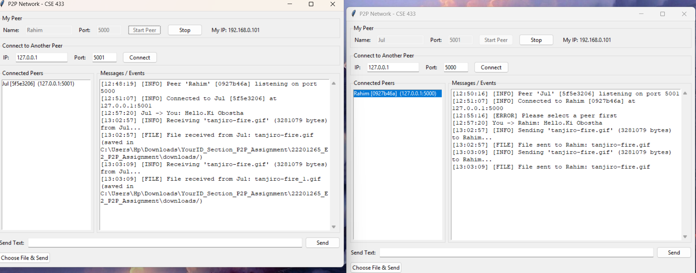
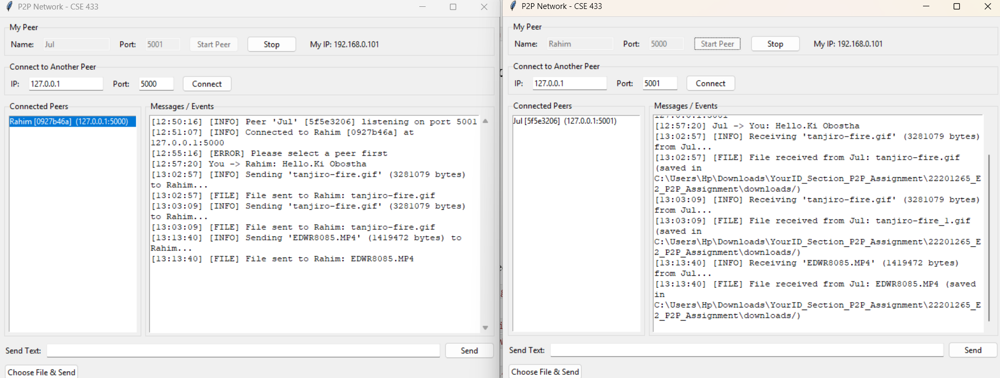
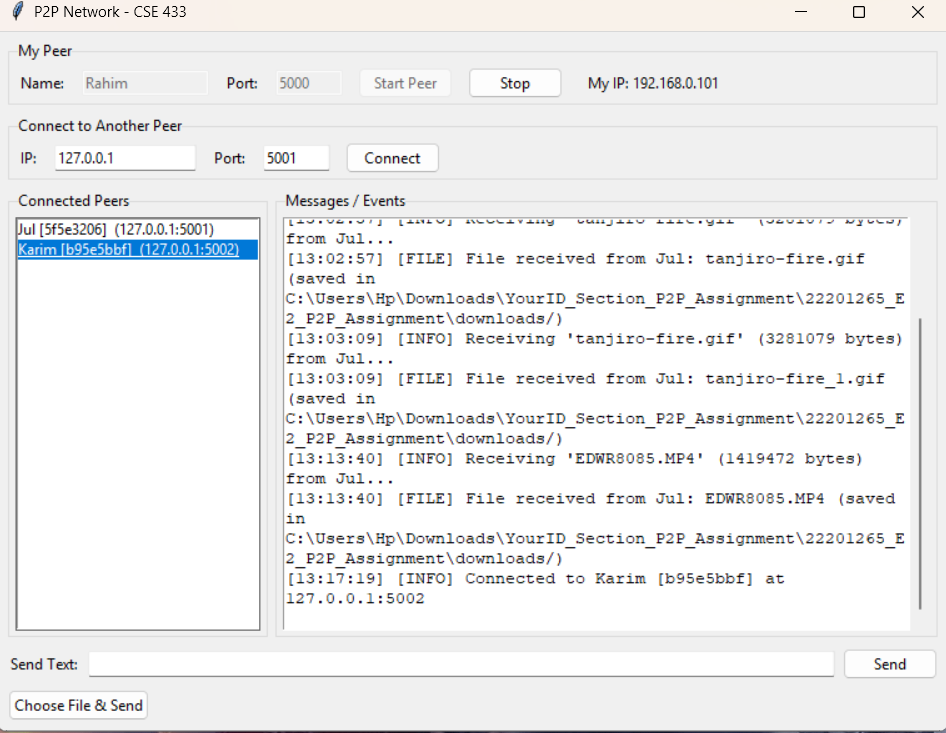
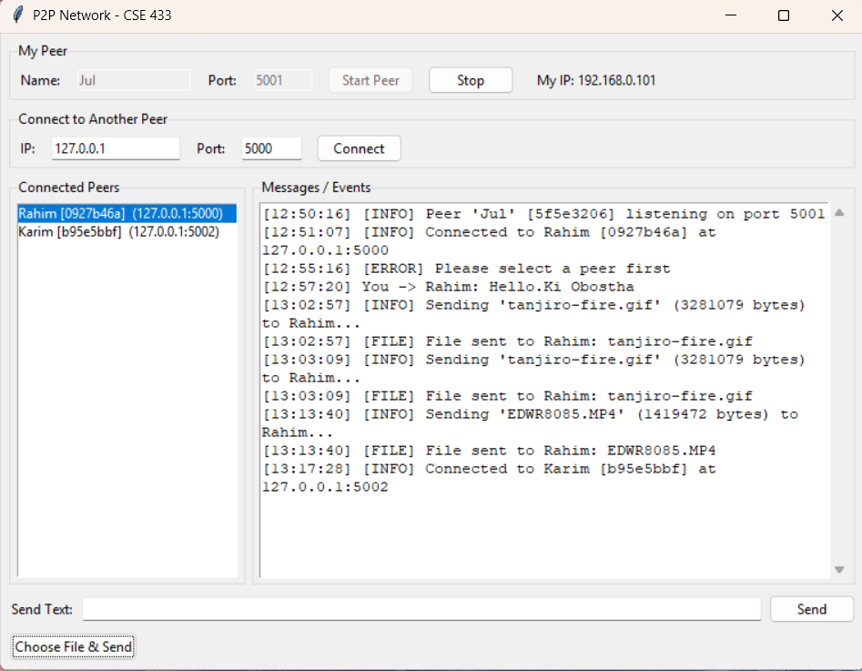
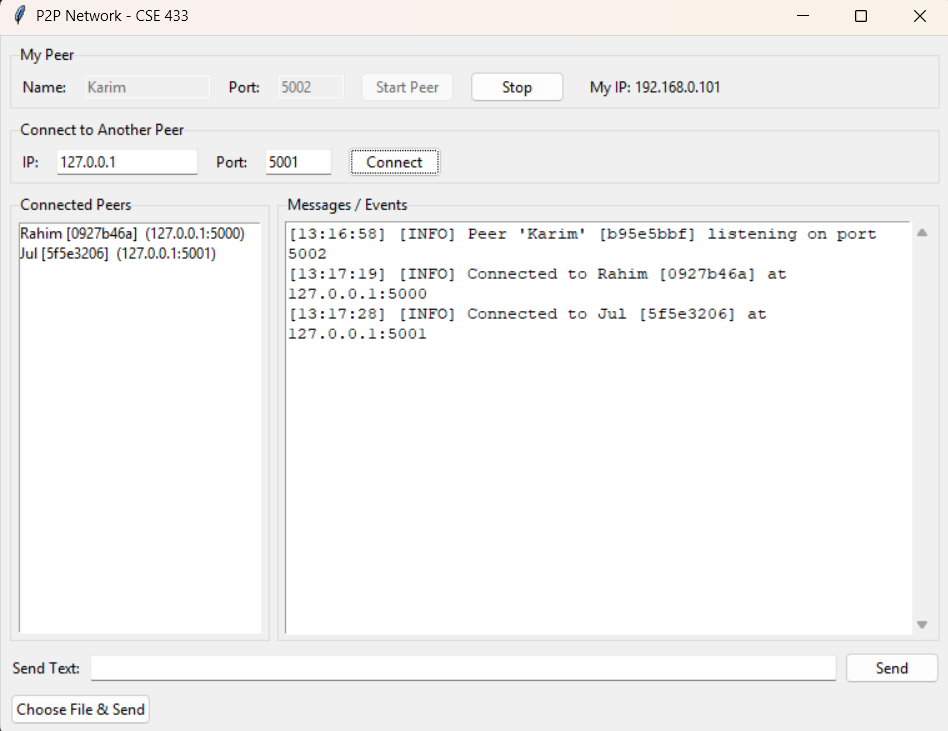
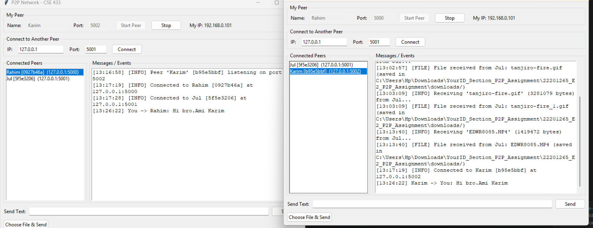
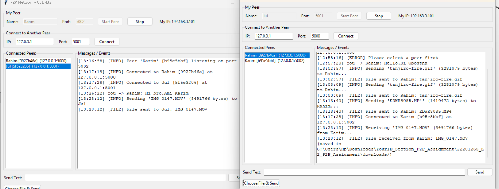

# P2P Network - Communication and File Sharing

**Course:** CSE 433 - Blockchain & Distributed Security Lab
**University:** University of Asia Pacific, Dept. of CSE
**Language:** Python 3 (TCP sockets, threads, Tkinter)

## 1. Project Description
A lightweight peer-to-peer application. Every running instance is one *peer* that acts as
both a **TCP server** (accepts incoming connections) and a **TCP client** (connects to other
peers). Peers connect directly using an IP address and a port, perform a HELLO handshake,
and then exchange **text messages** and **files** (text, image, audio, video, PDF, ZIP, ...).
There is **no central server**.

Messages use a simple application protocol: `[4-byte length][JSON payload]`.
A file is sent as JSON metadata (`filename`, `filesize`) followed by exactly `filesize` raw
bytes, streamed in 64 KB chunks.

## 2. Requirements
* Python 3.9 or later (Windows / Linux / macOS)
* Tkinter (comes with the standard Python installer on Windows/macOS;
  on Linux: `sudo apt install python3-tk`)
* No third-party packages (see `requirements.txt`)

## 3. Installation / Setup
1. Unzip the project folder.
2. Open the folder in VS Code (or any terminal).
3. Nothing to install.

## 4. How to Run
```
python main.py
```
(use `python3 main.py` on Linux/macOS). Run it once per peer; to test on one computer
open several terminals and run it in each.

## 5. How to Connect Two Peers
1. **Peer A:** enter name `Rahim`, port `5000`, click **Start Peer**.
2. **Peer B:** enter name `Jul`, port `5001`, click **Start Peer**.
3. On Jul's window enter `IP = 127.0.0.1` (same computer) or Rahim's LAN IP
   (shown as "My IP" in Rahim's window, e.g. `192.168.1.10`), `Port = 5000`, click **Connect**.
4. Both windows now show the other peer in **Connected Peers**.

Peers on different computers must be on the same Wi-Fi/LAN, and the firewall must allow
Python to accept incoming connections on the chosen port.
Different peers on the same computer must use different ports.

## 6. How to Send Text
Select a peer in the **Connected Peers** list, type in the text box and click **Send**
(or press Enter). The message appears in the receiver's log as `Rahim -> You: ...`.

## 7. How to Transfer Files
Select a peer, click **Choose File & Send**, pick any file. The receiver saves it in the
`downloads/` folder (existing files are never overwritten: `photo_1.jpg`, `photo_2.jpg`, ...).

## 8. Multiple Peers
Start a third peer (`Karim`, port `5002`) and connect it to Rahim and/or Jul.
Each peer keeps a separate connection (one thread each) with every peer it is connected to;
select the desired peer before sending.

## 9. Project Structure
| File | Responsibility |
|------|----------------|
| `main.py` | Tkinter user interface |
| `p2p_node.py` | Networking: server, client, threads, text and file transfer |
| `protocol.py` | Message building, framing (length prefix), encoding/decoding |
| `downloads/` | Received files are stored here |

## 10. Error Handling
Invalid IP/port, connection refused, timeout, unexpected disconnects, missing file,
invalid file size, sending without selecting a peer, connecting to yourself, and duplicate
connections are all reported in the log as `[ERROR] ...` without crashing the program.

## 11. Example Screenshots

**1. Peer started**



**2. Two peers connected (HELLO handshake)**



**3. Text message (Jul -> Rahim)**



**4. Image transfer**



**5. Video transfer**



**6. Three peers connected**







**7. Communication between multiple peers**



